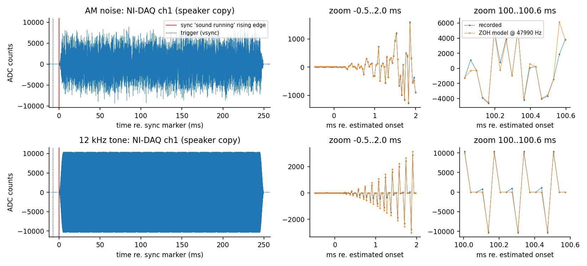
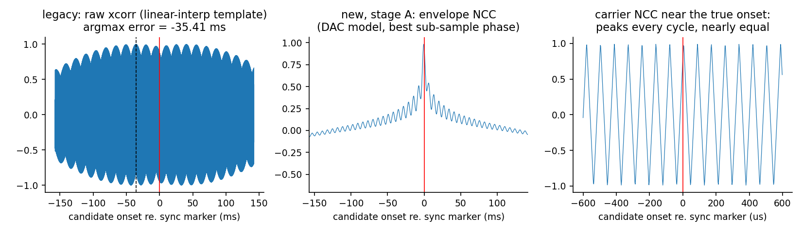
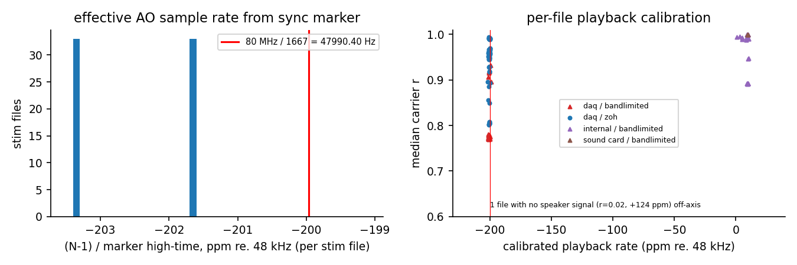
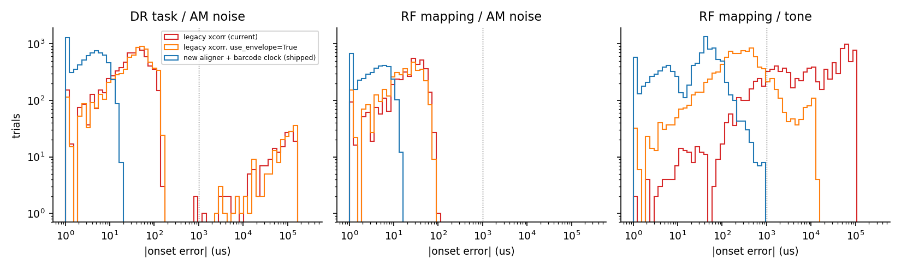
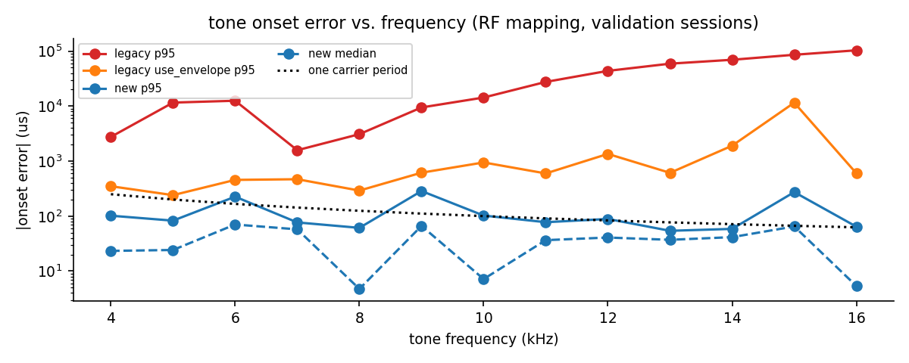
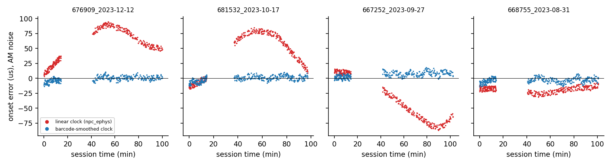
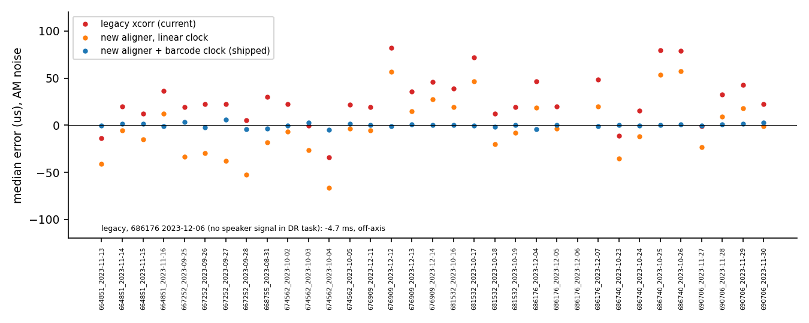
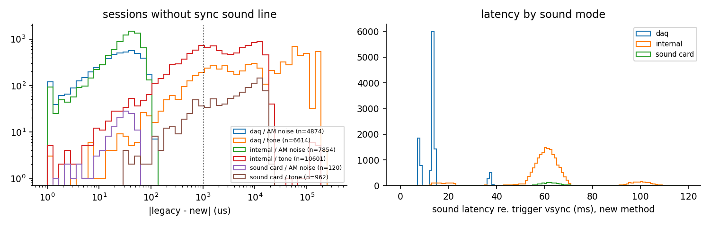

# Auditory stimulus onsets from the NI-DAQ speaker recording

*npc_samstim. Validation against the sync "sound running" line, and a replacement for the correlation method. 2026-11-17.*

## Summary

Sessions recorded before 2023-08-31 have no sync line marking sound onset. For these, `npc_samstim` finds each sound by correlating the ideal waveform with the PXI NI-DAQ recording of the speaker signal (channel 1). Sessions from 2023-08-31 onward have both the NI-DAQ recording and a sync line driven by the same analog-output sample clock as the sound. That makes it possible to measure the error of any NI-DAQ-based method directly.

The comparison used **33 such sessions** (2023-08-31 to 2023-12-14; 64 stim files; 21,069 sound trials):

| Stimulus (validation set) | Legacy `xcorr`: p95 \|error\| | Legacy: trials > 1 ms off | **New: median \|error\|** | **New: p95 \|error\|** | **New: max \|error\|** | New: trials > 1 ms off |
|---|---:|---:|---:|---:|---:|---:|
| Task AM noise (n=7,245) | 109 µs | 2.2 % | **3.7 µs** | **10.4 µs** | 18 µs | 0 (165 rejected as NaN, see §4.3) |
| RF-mapping AM noise (n=3,840) | 59 µs | 0 % | **3.7 µs** | **9.8 µs** | 16 µs | 0 |
| RF-mapping tones, 4–16 kHz (n=9,984) | **99.7 ms** | **85 %** | **35 µs** | **124 µs** | 0.87 ms | 0 |

**The main finding is that the legacy method fails on pure tones.** On 85 % of tone trials it is more than 1 ms wrong, typically by tens of ms and by up to 105 ms. Its `use_envelope=True` option is better but still more than 1 ms wrong on 12 % of tones, by up to 13 ms. Noise stimuli were already roughly right, with a +20–30 µs bias and about ±100 µs of slow drift.

On the 55 older sessions (2022-07-26 to 2023-08-30; 96 stim files; 31,027 trials), the new and legacy methods agree to tens of µs for noise. **For tones they disagree by more than 1 ms on 69–88 % of trials** (by sound mode). This pattern matches the validated legacy failure. In total, 63 older stim files contain tones: every RF-mapping file, plus DR-task sessions that used tones.

The new method, now the default for `waveform_type='sound'`:

1. **Models playback physically.** The NI-DAQ analog output is a zero-order hold (ZOH) at 80 MHz/1667 = 47,990.4 Hz, not 48 kHz. Sound-card output is modelled as band-limited. The effective rate is calibrated per stim file.
2. **Finds onsets in two stages.** A robust envelope correlation, evaluated over a fine grid of sub-sample phases, is followed by a carrier refinement within half a carrier period, used for noise only.
3. **Maps NI-DAQ samples to sync time through all ~200 matched barcodes**, smoothed. The existing map is a line through only the first and last barcode, and it misses about ±100 µs of non-linear clock drift.
4. **Returns NaN latency** when the recording does not match the waveform, instead of returning a wrong time.

The changes are in `src/npc_samstim/sound_alignment.py` (new) and `src/npc_samstim/waveforms.py`. Tests are in `tests/test_sound_alignment.py`, and experiment code in `experiments/aud_xcorr/`.

## 1. Data and ground truth

* **Signals.**
    * The PXI NI-DAQ (PXI-6133, about 30.03 kHz on the sync clock), channel 1, carries a copy of the speaker drive signal (Fig. 1).
    * In `soundMode='daq'`, `TaskControl.loadSound` writes the sound to AO channel 0 and 5 V to AO channel 1 for every sample but the last, on the same sample clock ([TaskControl.py](https://github.com/samgale/DynamicRoutingTask/blob/master/TaskControl.py)).
    * AO channel 1 is the sync "sound running" line. From 2023-08-31 its rising edge marks sample 0 of the sound, so it is the ground truth. Its resolution is 10 µs (sync sampled at 100 kHz).
* **Sessions.** I listed all `s3://aind-ephys-data/ecephys_*` sessions from 2022-06 onward and kept those with a DynamicRouting1 or RFMapping stim file, a sync file and PXI NI-DAQ data. That gave 90 sessions, all on rig NP3.
    * Three could not be fully extracted, all because of upstream frame-time or file issues rather than this method: 660023 2023-08-08 and 644867 2023-02-21 (RF) failed npc_stim frame matching, and for 670181 2023-07-18 the stim file is dated 07-20.
    * For the 3 sessions with two NI-DAQ recordings, the longer recording was used.
* **Sound modes.** `internal` (2022 to Feb 2023) and `sound card` (May 2023) are sound-card playback. `daq` (Jul 2023 onward) is NI-DAQ AO playback. *All validation sessions are `daq` mode* (see §6).
* **Stimuli.** Task: AM noise, 0.5 s; older task sessions: tones. RF mapping: tones at 4–16 kHz in 1 kHz steps and AM noise, 0.25 s, with 5 ms Hanning ramps for tones.
* For every trial I cached the trigger time (vsync of the stimulus start frame), the sync onset and offset, the ideal waveform as used by `npc_samstim`, and NI-DAQ ch1 from 0.2 s before the trigger to 0.35 s after the sound ends. All methods were then compared offline on identical inputs.
* **Replica check.** My offline replica of the legacy `xcorr` matches the library function exactly: max difference 0.0 s on 24 trials from 2 stim files, both raw and `use_envelope` (`experiments/aud_xcorr/results_check_baseline.txt`).



*Fig. 1. NI-DAQ ch1 for an AM-noise trial and a 12 kHz tone trial, session 668755 2023-08-31. Red: sync marker. Dotted: trigger vsync. Right panels: recorded samples against the ZOH playback model at 47,990 Hz, aligned at the estimated onset (NI-DAQ clock). The tone at 100 ms shows how strongly a 12 kHz tone is aliased at 30 kHz sampling.*

## 2. What was wrong with the legacy method

The legacy method correlates the NI-DAQ samples with the ideal waveform linearly interpolated to the NI-DAQ rate. It uses non-normalized correlation, integer lags, ±150 ms around the trigger, and the npc_ephys linear clock. Four problems were found.

1. **Tones are cycle-ambiguous, and the template is wrong for aliased tones.**
    * A 250 ms tone's correlation is a comb with one peak per carrier cycle. Adjacent peaks differ by about 10⁻⁴ (Fig. 2, right).
    * Tones up to 16 kHz sampled at 30 kHz alias strongly, and linear interpolation of the 48 kHz waveform does not reproduce what the NI-DAQ records.
    * Model mismatch is therefore much larger than the differences between peaks, and the argmax lands anywhere within the lag window (Fig. 2, left). Errors grow with frequency, from a p95 of 2.8 ms at 4 kHz to 103 ms at 16 kHz (Fig. 5).
2. **The DAC does not run at 48 kHz.**
    * NI-DAQmx derives the AO sample clock from an 80 MHz timebase, so 48 kHz becomes 80e6/1667 = 47,990.40 Hz (−200 ppm).
    * Independent evidence: the marker is high for N−1 samples, and (N−1)/(marker high-time) = 47,990.24–47,990.32 Hz across all 64 validation files (Fig. 3, left). That is 2–3 ppm from 47,990.40 Hz, which is the sync-clock versus DAQ-crystal difference.
    * A template 200 ppm too short is expected to bias the correlation peak by about half the stretch: +25 µs (0.25 s sounds) to +50 µs (0.5 s sounds). The observed legacy medians were +26 µs and +29 µs, with other error sources mixed in.
3. **The NI-DAQ→sync clock map is a line through only the first and last barcode.**
    * Real drift is smooth but non-linear, about ±100 µs over a session (Fig. 6). Every NI-DAQ-derived time inherits this error.
    * The same map is used for opto timing from NI-DAQ data, which this report does not address.
4. **There is no failure detection.** If the speaker signal is missing, a "best" lag is still returned.



*Fig. 2. A 12 kHz tone trial. Left: legacy correlation over the ±150 ms lag window. Its maximum is 35 ms from the truth. Middle: envelope NCC of the new method, with one clear peak at the truth. Right: carrier NCC near the true onset, at 2 µs resolution, with nearly equal peaks every cycle.*

## 3. New method

### 3.1 Playback model and per-file calibration

The recorded signal is modelled as the ideal waveform w[n] played at an effective rate f_eff and point-sampled at the NI-DAQ sample times t_k. For an onset τ:

* **ZOH** (NI-DAQ AO): x̂(t_k; τ) = w[ ⌊(t_k − τ) · f_eff⌋ ]
* **band-limited** (sound card): x̂(t_k; τ) = (sinc-interpolated w)((t_k − τ) · f_eff), implemented by 16× polyphase upsampling plus linear interpolation.

Both models include aliasing, because the template is evaluated at the actual NI-DAQ sample times rather than resampled.

Per stim file, 12 evenly spaced trials are used to choose the reconstruction type and rate. The candidate rates are a ±400 ppm grid in 20 ppm steps, plus the 80 MHz-derived rate, then a 2 ppm refinement with a parabola fitted to the peak. The criterion is the median carrier correlation.

Calibration recovers the physics without using metadata (Fig. 3, right):

| Sound mode | Files | Chosen model | Rate (ppm re. 48 kHz) | Median r |
|---|---:|---|---|---:|
| `daq` | 101 | ZOH (66), band-limited (35)¹ | −199.1 to −201.7 | 0.78–0.96 |
| `internal` | 58 | band-limited | +0.7 to +10.4 (median +9.5) | 0.99 |
| `sound card` | 3 | band-limited | +9.3 to +10.0 | 1.00 |

¹ Mostly task files (31 of 35). In the one inspected (676909 2023-12-13) the speaker signal is low amplitude (about ±1,000 counts), and these files choose either model with r ≈ 0.78. Timing accuracy on these files is unaffected (§4). One file with no speaker signal calibrated to +123 ppm with r = 0.02 and is rejected trial by trial.



*Fig. 3. Left: effective AO rate measured from the sync marker high-time. Right: per-file calibration result and its median correlation.*

### 3.2 Two-stage onset search

* **Stage A, envelope (robust).**
    * Normalized cross-correlation (NCC) of the 1 ms moving-RMS envelope of the recording with the envelope of x̂, over onsets from −20 ms to +250 ms re. the trigger.
    * The aliased envelope of a tone depends strongly on sub-sample phase, a vernier effect from ZOH images aliasing back near the tone. The template is therefore evaluated at 16 sub-sample phases over the whole window, then at 128 phases within ±1.5 ms of the best match (tones only).
    * Tone p95 error fell from 414 µs with 16 phases to 122 µs with 128, and to 116 µs with 256. 128 was chosen as the knee. Data: `experiments/aud_xcorr/exp_frac.py` output (8 sessions).
* **Stage B, carrier (precise, aperiodic sounds only).** NCC of the raw signal with x̂ within ± half the first autocorrelation side-peak lag of the template (half a period for tones; 0.25 ms for noise), at 1/32-sample resolution with parabolic refinement.
    * For periodic waveforms (tones) the stage A estimate is reported. In validation, stage B shifted tone estimates by a consistent 0.1–0.2 cycle, which wrapped to whole-cycle errors at 7, 9, 11, 13 and 15 kHz, i.e. a small phase mismatch in the model.
    * Periodicity detection matched the stimulus label on all 187 sampled trials (tones periodic, AM noise aperiodic).

### 3.3 Clock

t_sync(k) = a·k + b + r̃(k). Here (a, b) is a least-squares line through all matched barcodes, about one every 30 s, roughly 200 per session. r̃ is the 9-barcode (about 4.5 min) moving mean of the residuals, linearly interpolated. Each segment uses its local linear timing.

Smoothing windows of 3–15 barcodes and a local-linear variant performed within about 3 µs of each other at p95 (`experiments/aud_xcorr/eval_clock.py`).

### 3.4 Constant offset

With the barcode clock, AM-noise onsets were a constant **+19.7 µs** late relative to the marker. Per-session medians were 14.5–25.5 µs over 33 sessions. This is subtracted (`NIDAQ_SOUND_ONSET_CORRECTION_SEC = -19.7e-6`).

The likely cause is the relative timing of OpenEphys NI-DAQ TTL stamps (used for barcodes) and the analog samples, about half of a 33 µs sample, plus 2–4 µs of analog delay (fitted model delay). The mechanism is **not verified**. In validation statistics the offset is applied leave-one-session-out, so no session is scored with an offset fitted to itself.

### 3.5 Rejection

A trial gets latency NaN (`NullRecording`) if the envelope r is below 0.5, or, for aperiodic sounds, the carrier r is below 0.3.

For accepted validation trials, the 0.1th / 1st percentiles of envelope r are 0.62 / 0.88. For rejected trials the median is 0.06 and the max 0.38. Note that `FlexStimRecording.onset_time_on_sync` for a NaN latency returns the trigger time (via `np.nansum`). This is pre-existing behaviour, so callers should check `latency`.

## 4. Validation results

Full table: `tables/validation_summary.csv`. The rows below separate the effects of the estimator and of the clock.

| Stimulus | Method | median error (µs) | p50 \|e\| | p95 \|e\| | p99 \|e\| | max \|e\| | > 1 ms |
|---|---|---:|---:|---:|---:|---:|---:|
| Task AM noise | legacy | +28.8 | 34.6 | 108.8 | 90,224 | 154,860 | 2.2 % |
| | legacy, `use_envelope` | +38.9 | 42.0 | 122.5 | 94,511 | 158,020 | 2.2 % |
| | legacy + barcode clock | +29.2 | 29.7 | 86.9 | 90,190 | 154,889 | 2.2 % |
| | new, linear clock | −2.4 | 23.7 | 79.6 | 90.1 | 102.0 | 0 |
| | **new + barcode clock** | **+1.1** | **3.7** | **10.4** | **13.6** | **18.4** | **0** |
| RF AM noise | legacy | +25.6 | 25.7 | 58.7 | 72.1 | 95.3 | 0 |
| | new, linear clock | −4.4 | 9.8 | 30.7 | 50.0 | 64.0 | 0 |
| | **new + barcode clock** | **−2.5** | **3.7** | **9.8** | **11.9** | **16.3** | **0** |
| RF tones | legacy | −570 | 11,182 | 99,681 | 102,224 | 104,731 | 85.2 % |
| | legacy, `use_envelope` | +42.6 | 258.9 | 2,279 | 10,350 | 13,298 | 11.9 % |
| | new, linear clock | −4.5 | 35.0 | 126.1 | 277.4 | 857.3 | 0 |
| | **new + barcode clock** | **−2.5** | **35.2** | **123.6** | **278.6** | **867.1** | **0** |

* **Noise.** The estimator removes the legacy bias of +20–30 µs. The barcode clock removes the slow drift: p95 falls from 80 to 10 µs (Figs. 6–7). What remains (3.7 µs median) is close to the 10 µs quantization of the sync ground truth.
* **Tones.** This is a different problem. The estimator fix takes errors from about 100 ms to about 0.1 ms, and the clock makes little difference at that scale. Accuracy is limited to roughly one carrier cycle (Fig. 5).
    * The worst frequencies are 6, 9 and 15 kHz (p95 225–286 µs), i.e. simple rational fractions of the NI-DAQ rate (1/5, 3/10, 1/2), where the aliased envelope carries the least sub-sample information. 12 kHz (2/5) was also poor before the fine phase search.
    * Even on synthetic, noise-free data the envelope surface for a 7 kHz tone has near-ties of about 10⁻⁵ at sub-sample offsets, so this is a property of the measurement and not only of model mismatch.



*Fig. 4. Distribution of \|onset error\| in validation sessions, log–log. The dotted line is 1 ms. The legacy task-noise tail above 1 ms comes from the file with no speaker signal (§4.3).*



*Fig. 5. Tone onset error by frequency. The dotted line is one carrier period.*



*Fig. 6. AM-noise onset error over session time for 4 sessions, with the npc_ephys linear clock and with the barcode-smoothed clock. The gap is the time between RF mapping and the task.*



*Fig. 7. Per-session median error for AM noise. The barcode-clock points include the leave-one-session-out offset correction.*

### 4.1 Per-frequency table (tones, validation)

| kHz | legacy p95 | legacy > 1 ms | legacy `use_envelope` p95 | new median | new p95 | new max |
|---:|---:|---:|---:|---:|---:|---:|
| 4 | 2.76 ms | 57 % | 349 µs | 23 µs | 102 µs | 151 µs |
| 5 | 11.6 ms | 88 % | 240 µs | 24 µs | 83 µs | 124 µs |
| 6 | 12.5 ms | 90 % | 455 µs | 70 µs | 225 µs | 335 µs |
| 7 | 1.58 ms | 34 % | 468 µs | 57 µs | 77 µs | 96 µs |
| 8 | 3.09 ms | 65 % | 291 µs | 5 µs | 61 µs | 74 µs |
| 9 | 9.45 ms | 80 % | 615 µs | 66 µs | 286 µs | 681 µs |
| 10 | 14.3 ms | 94 % | 945 µs | 7 µs | 102 µs | 144 µs |
| 11 | 27.5 ms | 100 % | 597 µs | 37 µs | 77 µs | 94 µs |
| 12 | 43.7 ms | 100 % | 1.35 ms | 41 µs | 89 µs | 134 µs |
| 13 | 59.1 ms | 100 % | 612 µs | 37 µs | 54 µs | 91 µs |
| 14 | 69.6 ms | 100 % | 1.91 ms | 41 µs | 59 µs | 115 µs |
| 15 | 85.8 ms | 100 % | 11.5 ms | 65 µs | 273 µs | 867 µs |
| 16 | 103.4 ms | 100 % | 599 µs | 5 µs | 64 µs | 113 µs |

(768 trials per frequency.)

### 4.2 End-to-end check through the public API

`get_stim_latencies_from_nidaq_recording(..., waveform_type='sound')` was run on S3 data against `get_stim_latencies_from_sync` for two sessions. This exercises segment reading, the barcode clock built from the sync file, calibration, alignment and the constant offset. Results are in `experiments/aud_xcorr/results/e2e_trials_final.csv`.

| Session | Stim | Stimulus | n | NaN | New: median | New: p95 \|e\| | New: max | Legacy: median | Legacy: p95 \|e\| |
|---|---|---|---:|---:|---:|---:|---:|---:|---:|
| 668755 2023-08-31 | task | AM noise | 233 | 0 | −3.0 µs | 9.7 µs | 13.2 µs | +45.4 µs | 82.0 µs |
| | RF | AM noise | 120 | 0 | −4.6 µs | 11.1 µs | 13.7 µs | +19.6 µs | 45.6 µs |
| | RF | tone | 312 | 0 | −4.2 µs | 81.3 µs | 178 µs | −1.24 ms | 102 ms |
| 676909 2023-12-12 | task | AM noise | 232 | 0 | +0.8 µs | 6.7 µs | 10.9 µs | +95.4 µs | 131 µs |
| | RF | AM noise | 120 | 0 | −4.1 µs | 10.7 µs | 13.2 µs | +52.0 µs | 76.2 µs |
| | RF | tone | 312 | 0 | −4.2 µs | 115 µs | 173 µs | +28.8 µs | 99.8 ms |

Wall time per stim file, including S3 reads: 74–178 s for the new method and 101–149 s for legacy. Threaded segment reads offset the extra computation.

### 4.3 Rejected trials

All 165 rejected validation trials belong to one file: 686176 2023-12-06, DR task. That session's task spans two NI-DAQ recordings, and the one used (recording1) has no matching speaker signal during the task (envelope r ≈ 0.05). Legacy returned times more than 1 ms wrong for 98.8 % of these trials. Outside that file no validation trial was rejected, and no accepted trial is more than 1 ms off.

In older sessions, 2 trials were rejected (666986 2023-08-14, RF). The recording there contains a different, louder sound overlapping the expected one.

## 5. Older sessions (no sync sound line)



*Fig. 8. Left: \|legacy − new\| onset difference in the 55 older sessions, by sound mode and stimulus. Right: sound latency re. trigger (new method) by sound mode.*

| Sound mode | Stimulus | Trials | p50 \|legacy − new\| | p95 | > 1 ms |
|---|---|---:|---:|---:|---:|
| `daq` | AM noise | 4,874 | 25 µs | 77 µs | 0 % |
| `daq` | tone | 6,614 | 14.4 ms | 169 ms | **87.6 %** |
| `internal` | AM noise | 7,854 | 35 µs | 70 µs | 0 % |
| `internal` | tone | 10,601 | 2.1 ms | 14.2 ms | **68.5 %** |
| `sound card` | AM noise | 120 | 30 µs | 51 µs | 0 % |
| `sound card` | tone | 962 | 5.4 ms | 15.0 ms | **81.4 %** |

Latency from trigger to sound (1st / 50th / 99th percentile):

* `daq`: 7.2 / 13.5 / 37.8 ms. The modes about 16.7 ms apart look like one-frame delays.
* `internal`: 14.7 / 61.1 / 104.8 ms.
* `sound card`: 53.6 / 62.4 / 70.2 ms.

The new default search window (−20 to +250 ms) covers these. The legacy ±150 ms also covers them, so latency range does not explain the legacy errors.

**Implication.** Any analysis aligned to auditory onsets in pre-2023-08-31 sessions should be regenerated where tones were used, i.e. RF-mapping tone responses and tone-based task sessions. Noise-aligned data shift by only tens of µs.

## 6. Limitations and open questions

* **Validation covers `daq` mode on rig NP3 only.** For `internal` and `sound card` sessions, the evidence is indirect:
    * calibration finds a band-limited model at about +10 ppm with r = 0.99–1.00, a better fit than in `daq` mode;
    * noise agrees with legacy to tens of µs;
    * the tone failures match the validated legacy failure.

    Absolute accuracy there is **not verified**. Sound-card output filters add their own delay, so what is measured is when the signal reaches the NI-DAQ, which is the physically relevant time.

* **The +19.7 µs offset is assumed to transfer to older sessions.** The NI-DAQ model (PXI-6133) and rig are the same, but OpenEphys versions may differ. If it doesn't transfer, the error is at most about 20 µs.

* **Tone precision is about one carrier cycle** (p95 ≤ 0.29 ms, max 0.87 ms). Better would need a per-frequency phase calibration of the analog chain.

* **Runtime.** Computation per session, single process on cached data: about 1.7 min for a `daq` session (task + RF) and about 7 min for an `internal` session (band-limited model, tones up to 1 s). Legacy takes seconds on cached data. Through S3 the totals are similar (§4.2), because legacy reads segments serially. Most of the compute is calibration (12 trials × about 85 candidate models) and the 128-phase tone search.

* **Multiple NI-DAQ recordings** in one session (3 of 90) need the caller to pass the recording that covers the stimulus.

* **Clock wander also affects opto timing** derived from NI-DAQ data. `get_nidaq_clock` could be reused there; this was not done or tested.

* **`npc_ephys.get_ephys_timing_on_sync`** fits through the first and last barcodes only. Fixing it upstream would improve every NI-DAQ- and probe-derived time, but probe clocks were not evaluated.

## 7. Reproduction

Data cache (about 6.4 GB, not committed), evaluation and figures:

```bash
cd experiments/aud_xcorr
python discover.py                  # list sessions -> sessions.json
python extract.py                   # cache NI-DAQ segments, waveforms, sync GT (S3)
python fetch_barcodes.py            # cache barcode pairs
python check_baseline.py            # replica == library legacy xcorr
python evaluate.py 12               # legacy methods (results/trials.csv)
python evaluate_final.py 12         # shipped pipeline (results/final_trials.csv)
python analyze.py                   # figures/tables -> outputs/aud-onset-xcorr/
python e2e_check.py 668755_2023-08-31 676909_2023-12-12   # public API on S3
pytest tests                        # incl. tests/test_sound_alignment.py
```

`_creds.py` resolves AWS credentials through boto3 and exports them, because aiobotocore cannot launch a `credential_process` under the Windows event loop.

## Sources

* DynamicRoutingTask `TaskControl.py` (sound output, AO channels, rig config): <https://github.com/samgale/DynamicRoutingTask/blob/master/TaskControl.py>
* DynamicRoutingTask `TaskUtils.makeSoundArray`: <https://github.com/samgale/DynamicRoutingTask/blob/master/TaskUtils.py>
* npc_sync `FIRST_SOUND_ON_SYNC_DATE`, sync line 1: `npc_sync/sync.py` (installed v0.1.24)
* npc_ephys barcode alignment: `npc_ephys/openephys.py::get_ephys_timing_on_sync`, `npc_ephys/barcodes.py` (installed v0.1.1)
* Data: `s3://aind-ephys-data/ecephys_*` (behavior/, ecephys_clipped/, ecephys_compressed/)
* Artifacts: `outputs/aud-onset-xcorr/tables/*.csv`, `outputs/aud-onset-xcorr/numbers.json`, `experiments/aud_xcorr/results/`
